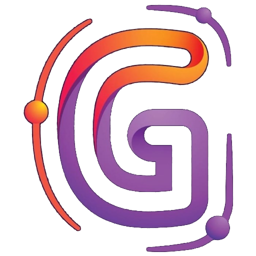

<div align="center">

  <a href="https://github.com/aryamanm77/gravix">
    
  </a>

  # Gravix

  ### **Effortless Account & Quota Switching for Antigravity IDE**

  <p align="center">
    Seamlessly switch Google accounts, monitor real-time Gemini &amp; Claude quotas, and keep long-running coding agents powered without interruption.
  </p>

  <p align="center">
    <a href="https://github.com/aryamanm77/gravix/releases/tag/v0.6.1"></a>
    <a href="https://github.com/aryamanm77/gravix"></a>
    <a href="https://github.com/aryamanm77/gravix"></a>
    <a href="#privacy--security"></a>
    <a href="LICENSE"></a>
  </p>

  <p align="center">
    <a href="https://gravix-navy.vercel.app"><b>🌐 Visit Interactive Web Landing Page</b></a>
    &nbsp;•&nbsp;
    <a href="https://github.com/aryamanm77/gravix/releases"><b>📦 Download VSIX Package</b></a>
    &nbsp;•&nbsp;
    <a href="#features"><b>✨ Explore Features</b></a>
  </p>

</div>

---

## ⚡ Quick 1-Line Terminal Install

Choose your platform below to download and install Gravix in one command:

### 🪟 Windows (PowerShell)
```powershell
curl.exe -L "https://raw.githubusercontent.com/aryamanm77/gravix/main/public/gravix-0.6.1.vsix" -o gravix.vsix; code --install-extension gravix.vsix
```

### 🍎 🐧 macOS & Linux (Bash / Zsh)
```bash
curl -sL "https://raw.githubusercontent.com/aryamanm77/gravix/main/public/gravix-0.6.1.vsix" -o gravix.vsix && code --install-extension gravix.vsix
```

> [!TIP]
> **Manual IDE Installation:** In Antigravity IDE, press <kbd>Ctrl</kbd> + <kbd>Shift</kbd> + <kbd>P</kbd> (or <kbd>Cmd</kbd> + <kbd>Shift</kbd> + <kbd>P</kbd> on macOS) → search for **Extensions: Install from VSIX...** → select the downloaded `gravix-0.6.1.vsix` file.

---

## 🖥️ Live Sidebar Preview

```text
┌────────────────────────────────────────────────────────────────────────┐
│ 🟣 Gravix — Antigravity IDE Quota & Account Manager                    │
├────────────────────────────────────────────────────────────────────────┤
│ 🛡️ Auto Quota Switch: [ Gemini 2.5 Pro · ACTIVE ]                     │
├────────────────────────────────────────────────────────────────────────┤
│ 👤 aryamanm77@gmail.com                                   [ ACTIVE ]   │
│    ├─ Gemini 2.5 Pro      ████████████████████ 100% (Resets in 4h 12m) │
│    ├─ Claude 3.5 Sonnet   ████████████████░░░░  84% (Resets in 1h 45m) │
│    └─ Gemini 2.5 Flash    ██████████████████░░  92% (Resets in 6h 30m) │
│                                                                        │
│ 👤 secondary.dev@gmail.com                                [ READY ]    │
│    ├─ Gemini 2.5 Pro      ██████████████████░░  90% (Resets in 7h 10m) │
│    ├─ Claude 3.5 Sonnet   ████████████████████ 100% (Full Quota)       │
│    └─ Gemini 2.5 Flash    ████████████████████ 100% (Full Quota)       │
└────────────────────────────────────────────────────────────────────────┘
```

---

## ✨ Features Built for Modern AI Developers

| Feature | Details |
| :--- | :--- |
| ⚡ **Instant Account Switching** | Swap active IDE accounts in under a second with atomic verification and automatic rollback safety. |
| 📊 **Live Quota Telemetry** | Direct inspection of Google Cloud Code endpoints for Gemini 2.5 Pro, Flash, Claude, and OpenAI models. |
| 🛡️ **Auto Quota Switch Guardian** | Monitors model exhaustion in the background and proactively offers an account with ready quota before tasks fail. |
| 🌐 **Chrome Profile Importer** | Discover and link accounts directly from your existing local Chrome browser profiles without retyping passwords. |
| 🔒 **100% Local & Private** | Direct PKCE OAuth with zero external tracking. Your refresh tokens never leave your encrypted local machine storage. |
| 🎨 **Cosmic Gradient Aesthetics** | Bespoke visual theme matching the Antigravity IDE dark cosmic palette with clean vector SVG icons. |

---

## 🚀 How to Install in 3 Steps

1. **Download VSIX**  
   Download [`gravix-0.6.1.vsix`](https://raw.githubusercontent.com/aryamanm77/gravix/main/public/gravix-0.6.1.vsix) directly or run the 1-line curl command above.

2. **Install into Antigravity IDE**  
   Run `code --install-extension gravix.vsix` in your terminal or use **Extensions: Install from VSIX** from the Command Palette (<kbd>Ctrl</kbd>/<kbd>Cmd</kbd> + <kbd>Shift</kbd> + <kbd>P</kbd>).

3. **Reload & Enjoy**  
   Reload the IDE window. Click the **Gravix** icon in your Activity Bar to manage accounts and monitor quotas.

---

## 🔍 Reading Quota Telemetry & Status Codes

Gravix polls Google Cloud Code services to provide real-time status badges for each connected account:

| Status Badge | Indicator | Meaning | System Behavior |
| :---: | :---: | :--- | :--- |
| `🟢 Available` | Ready | Fresh check reported positive model quota. | Ready for immediate coding agent execution. |
| `🔴 Exhausted` | Zero | Service reported 0% quota remaining. | Auto-switch guardian triggers search for alternatives. |
| `🟡 Needs Refresh` | Stale | Cached data is older than 5 minutes or last call failed. | Triggers background refresh when window gains focus. |
| `🔵 Recheck` | Pending | Reported reset time has elapsed; confirming renewal. | Account rechecked before presenting switch offer. |
| `⚪ Unknown` | Unusable | Service did not report standard quota payload. | Safeguarded; never assumed available. |

> [!NOTE]
> **Reset Countdowns:** Hover over any model's reset countdown to inspect the exact date and time of replenishment in your local timezone. Full-quota models omit countdowns to avoid uninformative 7-day rolling timestamps.

---

## 🔄 Account Switching & Session Rollback

- **1-Click Switching:** Click **Switch account** on any ready account card. Switching restarts the language server to bind the new credentials. The extension verifies the token and IDE profile before declaring the account active.
- **Safety Rollback:** If a switch ever fails or if you want to return to your prior workspace state, expand **Session controls** and select **Restore previous session**.
- **Agent Task Safety:** Finish or pause active coding agent operations before initiating a switch to ensure clean context preservation.

---

## 🛡️ Watch a Model’s Quota (Auto-Switch Guardian)

Enable **Ask to switch when quota runs out** on any desired model (e.g., *Gemini 2.5 Pro*):

1. **Active Background Check:** The focused IDE window checks the active account every **20 seconds**, even if the sidebar is closed.
2. **Exhaustion Detection:** When remaining quota hits 0%, Gravix checks alternative saved accounts in small parallel batches.
3. **Approval Prompt:** A notification and persistent sidebar prompt surface the best available candidate account.
4. **Seamless Transition:** Upon clicking **Switch account**, the IDE transitions seamlessly, and the guardian resumes monitoring the same model on the new account.

---

## 🌐 Chrome Profile Importer

Import multiple developer accounts in seconds:

- Gravix reads local profile names and Google account email hints from Chrome's local metadata (`Local State` / `Preferences`).
- **Zero credential scraping:** Passwords and cookies are never accessed.
- Each account opens a temporary dedicated OAuth app window in its native Chrome profile for explicit user consent.
- Accounts already configured in Gravix are skipped automatically.
- Upon completion, the OAuth callback window automatically closes itself and advances to the next profile.

---

## 🔒 Privacy & Security

Gravix is architected with a strict security-first philosophy:

- **Encrypted Local Storage:** All tokens and account snapshots are stored directly within the IDE's native `SecretStorage` keychain.
- **Zero Intermediary Servers:** All authentication and quota verification requests travel directly to Google endpoints (`accounts.google.com` and Google Cloud Code service hosts).
- **Zero Telemetry:** No user analytics, metrics, or personal data are ever tracked, collected, or transmitted.
- **Safe Revocation:** Removing an account from Gravix deletes its manager entry and stored tokens from local storage immediately.

---

## 🛠️ Build from Source

```bash
# Clone the repository
git clone https://github.com/aryamanm77/gravix.git
cd gravix

# Install dependencies and run tests
npm ci
npm run check
npm test

# Package VSIX
npm run package
```

To run a development instance on Windows:

```powershell
& "$env:LOCALAPPDATA\Programs\Antigravity IDE\bin\antigravity-ide.cmd" --new-window --extensionDevelopmentPath="$PWD"
```

---

## ❓ Troubleshooting

<details>
<summary><b>The Gravix sidebar icon is missing from the Activity Bar</b></summary>
<br>
Run <code>Developer: Reload Window</code> from the Command Palette (<kbd>Ctrl</kbd>/<kbd>Cmd</kbd> + <kbd>Shift</kbd> + <kbd>P</kbd>), then execute <code>Gravix: Open Sidebar</code>.
</details>

<details>
<summary><b>Quota exhaustion occurred but no notification appeared</b></summary>
<br>
Ensure <b>Ask to switch when quota runs out</b> is toggled on for your active model and that your active account is saved in Gravix. Quota checks operate when the IDE window is focused.
</details>

<details>
<summary><b>An account requires signing in again</b></summary>
<br>
Click <b>Connect account</b> on the card to refresh Google credentials. Token rotation is handled automatically whenever the IDE profile identifies the saved account.
</details>

<details>
<summary><b>Quota verification check failed</b></summary>
<br>
Click <b>Refresh</b>. If you recently connected a brand new account, ensure it has completed Antigravity onboarding in the IDE before running checks.
</details>

---

## 📄 License & Attribution

- Created and published by **[Aryaman-M](https://github.com/aryamanm77)**.
- Licensed under the **[Apache License 2.0](LICENSE)**.
- Forked from and indebted to Ron-Niri's Antigravity Account Manager.
- Google, Gemini, Chrome, Claude, and Antigravity IDE are trademarks of their respective owners. Gravix is an independent open-source project.
